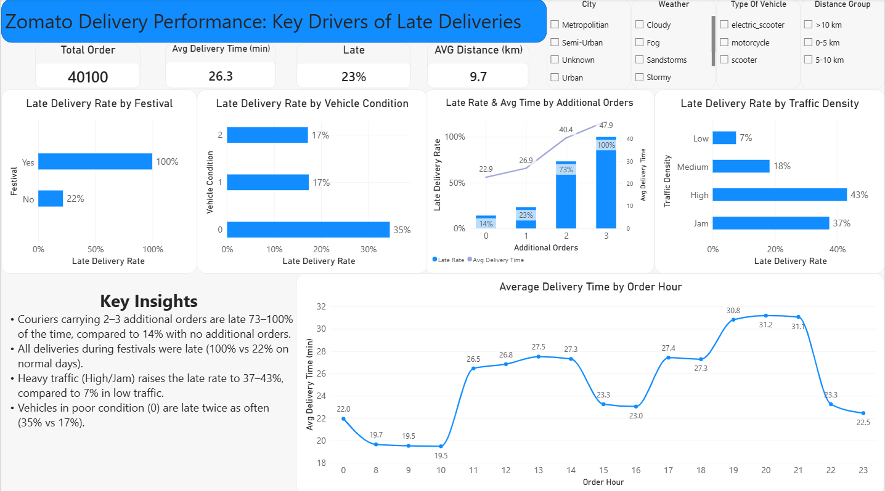

# Zomato Delivery Analysis — What Makes Deliveries Late?

Take Home Test — Data Analyst Bootcamp

## Problem Statement
Which factors most affect late deliveries, and which operational conditions can be optimized?

## Dataset
[Zomato Delivery Operations Analytics Dataset (Kaggle)](https://www.kaggle.com/datasets/saurabhbadole/zomato-delivery-operations-analytics-dataset)
45,584 rows × 20 columns → 40,100 rows after cleaning.

## Files
| File | Description |
|---|---|
| `Take Home Test.ipynb` | Data cleaning, feature engineering, and EDA (Python) |
| `Take Home Test.pbix` | Interactive Power BI dashboard |
| `zomato_clean.csv` | Cleaned dataset used for the dashboard |
| `What Makes Deliveries Late — Zomato Delivery Operations Analytics.pdf` | Presentation slides |
| `images/dashboard.png` | Dashboard screenshot |

## Key Findings
- Carrying 2–3 additional orders raises the late rate from 14% to 73–100%, and average delivery time from 22.9 to 40–48 min
- All deliveries during festivals were late (100% vs 22%), taking 45.5 min on average vs 26.0 min
- Heavy traffic raises the late rate to 37–43%, vs 7% in low traffic
- Condition-0 vehicles are late twice as often (35% vs 17%)

## Tools
Python (pandas, numpy, matplotlib, seaborn) · Power BI
